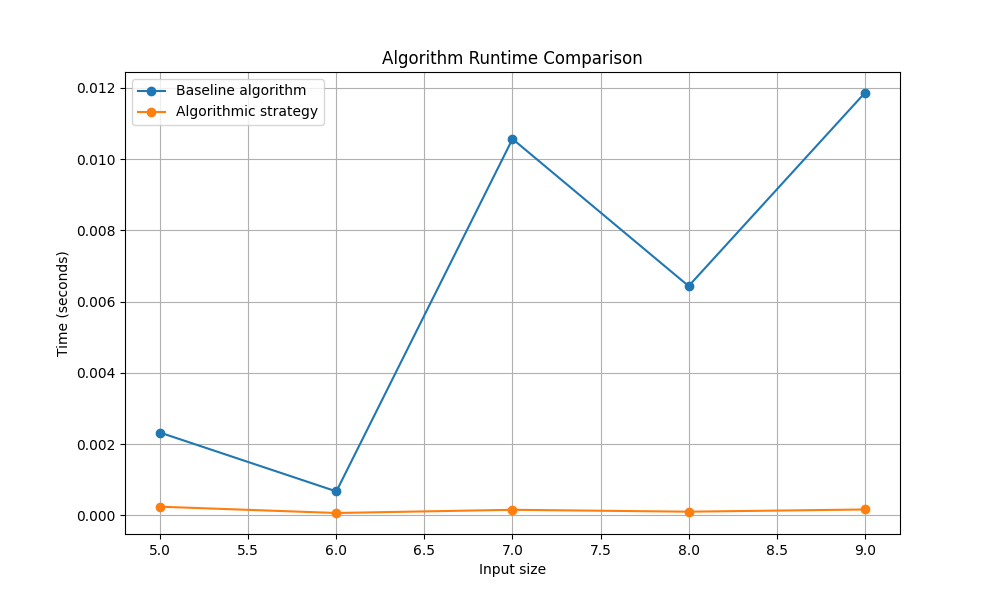
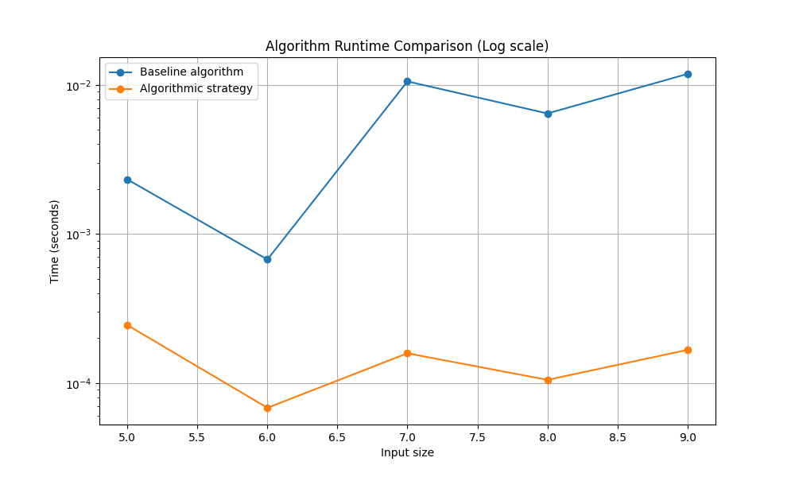

# Empirical Evaluation

## Overview
We implemented our two algorithms (`main.py`) that solve the strand matching problem:
1.  **Baseline Algorithm:** Naive recursive strategy, checking if the current index of the 2 strands are equal to each other, then making a recusive branch to capture every possibility.
2.  **Proposed Algorithm:** storing any already computered calaulations into a dictonary and to return that value instead of repeating already computered soultions.

Unit testing (`ptests.py`) confirms that both algorithms return the correct minimum computing cost as they were printed out the same result..

## Benchmarking Results
We compare the performance of our two algorithms on randomly generated strands, with varying input size ($n$), and varying mutations ($m$) from (5,5) to (9, 13) size/mutation, with each strand containg up to 9 different opps, and each mutation effecting either strand and adding or removing an opp. We present the results in the plots below. The left plot shows the execution time on a linear scale, while the right plot uses a logarithmic scale for both axes.

|  |  |
|---|---|

The empirical data aligns with our theoretical complexity analysis (`planning.md`):

*   **Baseline Quadratic Scaling:** The baseline algorithm theoretically scales at $\mathcal{O}(3^(m+n))$ due to repeatedly sloving each recusive branch.
*   **Proposed Algorithm Efficiency:** The proposed algorithm scales at $\mathcal{O}(nm)$, as there can only be m*n values within the dictornary, which causes the algorithem to be constant time once every value is able to be recalled.