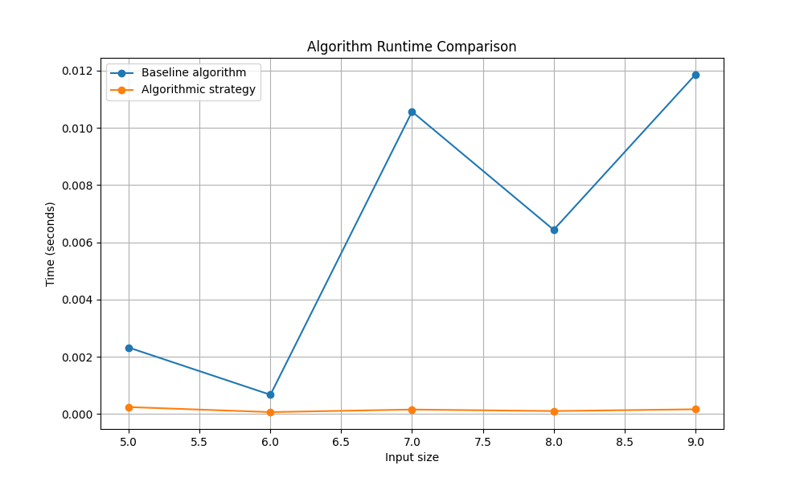

## Empirical Synthesis: 
We created visualizations using our benchmarking data. These visualizations show that our algorithm scales more slowly than the $O(n^{m+n})$ baseline, demonstrating improved performance as the input size increases.

|  |  |
|---|---|

## Baseline Comparison: 
Our algorithmic analysis shows that our solution scales more slowly than the baseline, visually demonstrating an improvement in runtime. This comparison shows how choosing a more efficient memoization approach can improve an algorithm's performance compared with running each recursive branch to the end.

## Reflection: 
The main challenge we had was developing the memoization approach. Conceptually working out the logic and storing the values properly to ensure the correct result was more challenging than it first appeared. The structural pivot we discovered was storing the computed branches as keys of tuples, and recording the score and the current alignment of the strands. The debugging process included ensuring the function returned the correct result. We ensured this by working out the correct answer on paper before running the same input into the algorithm. Some improvements we implemented from feedback from previous weeks were ensuring spelling mistakes were fixed and further explaining our solution.
